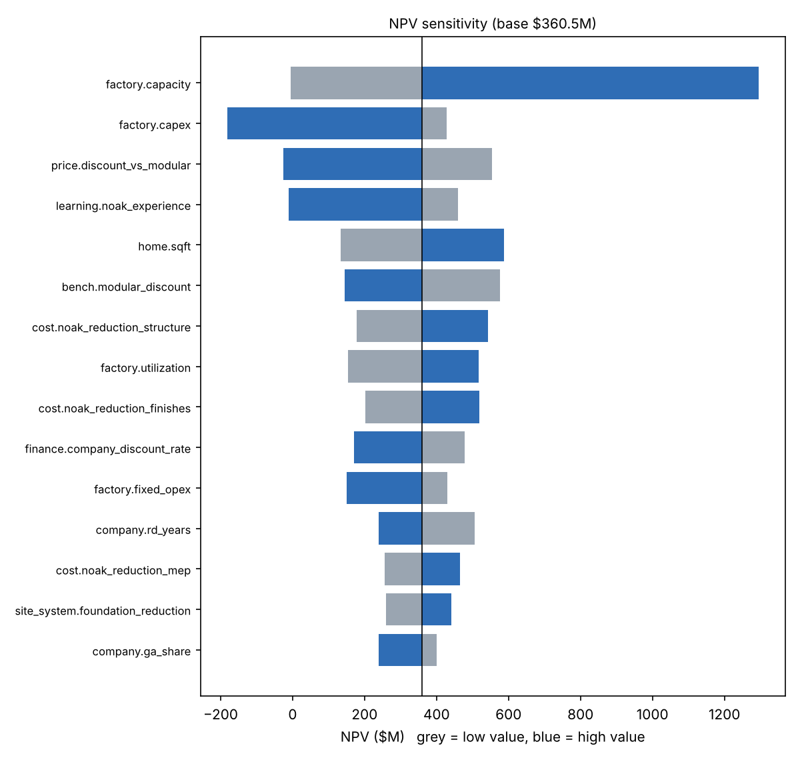

# Automated factories for electrified prefab homes: TEA results

## Conventions

- Real 2026 US dollars (pre-tax). Canadian figures converted at the fx rate below.
- Unit costs are entered at NOAK (Nth of a kind). The cost of getting there is shown separately with Wright's-law learning curves.
- **Boundary:** Design, factory build, transport, set and finish a single-family home, plus energy and service add-ons. Excludes land and lot development.
- **Functional units:** Installed price per sq ft excluding land; months from permit to occupancy; buyer's cost of waiting; owner's annual cost of home plus energy.
- Company discount rate 10%, customer discount rate 8%, horizon 15 years.

## Headline

| Metric | Value |
|---|---|
| NPV | $360.5M |
| IRR | 28% |
| Probability NPV > 0 (Monte Carlo) | 43% |
| Peak cash need | $237.2M |
| Cash breakeven year | 10 |
| Revenue in final year | $2.02B |
| NOAK reached in year | 8 |
| Extra cost paid while learning (FOAK to NOAK) | $295.5M |
| NPV if costs started at NOAK (no learning period) | $537.1M |

## Customer cost vs BAU

**Installed home, excluding land** ($/sq ft)

| Option | Value | vs ours |
|---|---|---|
| Ours at NOAK price | $175 | 1.00x |
| Conventional modular | $184 | 1.05x |
| Site-built | $217 | 1.24x |
| Manufactured (HUD code, reference) | $87 | 0.50x |
| Ours priced at NOAK full cost | $143 | 0.81x |

Full cost includes factory overhead, capex, selling, warranty, G&A and construction financing at full utilization.

**Time to occupancy** (months from permit)

| Option | Value | vs ours |
|---|---|---|
| Ours | 3.5 | 1.00x |
| Conventional modular | 6.9 | 1.97x |
| Site-built | 8.8 | 2.51x |

**Buyer's cost of waiting for the home** ($ per home)

| Option | Value | vs ours |
|---|---|---|
| Ours | $8,750 | 1.00x |
| Conventional modular | $17,250 | 1.97x |
| Site-built | $22,000 | 2.51x |

Months from permit to occupancy x rent or a second housing payment.

**Owner's annual cost (home + energy)** ($/yr)

| Option | Value | vs ours |
|---|---|---|
| Ours, all-electric with the regional package (sales-weighted) | $26,811 | 1.00x |
| Ours, all-electric, no package | $27,003 | 1.01x |
| Conventional modular, mixed fuel | $28,424 | 1.06x |
| Site-built, mixed fuel | $32,911 | 1.23x |

Home price and package financed over 30 years at the mortgage rate; excludes land, taxes and insurance.

**Energy package by region: owner's net gain per year, financed in the mortgage**

| Region | Sales | Retail $/kWh | Export $/kWh | VPP $/kW-yr | Solar only | Solar + battery | We offer |
|---|---|---|---|---|---|---|---|
| CA / HI (high rates, net billing) | 8% | $0.320 | $0.050 | $70 | $887 | $1,145 | solar + battery |
| New England / NY (high rates, net metering, battery programs) | 5% | $0.300 | $0.300 | $250 | $921 | $707 | solar |
| Southeast (full net metering) | 35% | $0.150 | $0.150 | $0 | $156 | $-671 | solar |
| Texas-style buyback | 27% | $0.155 | $0.060 | $75 | $-61 | $-408 | none |
| Mountain / Midwest (cheap power, net billing) | 25% | $0.130 | $0.040 | $0 | $-359 | $-927 | none |

## FOAK to NOAK

Cost multiplier vs the incumbent's cost for each component (1.00 = incumbent).

| Component | FOAK | NOAK |
|---|---|---|
| structure | 1.91 | 0.65 |
| mep | 1.51 | 0.75 |
| finishes | 1.61 | 0.80 |
| site | 1.46 | 0.73 |
| final | 1.41 | 0.70 |

## Cash flow

| Year | Phase | Revenue | Gross profit | Operating cost | EBIT | Capex | Cumulative cash | Cost vs incumbent |
|---|---|---|---|---|---|---|---|---|
| 1 | R&D | $0 | $0 | $15.0M | -$15.0M | $0 | -$15.0M | 1.68 |
| 2 | R&D | $0 | $0 | $15.0M | -$15.0M | $0 | -$30.0M | 1.68 |
| 3 | commercial | $32.0M | -$21.2M | $11.0M | -$32.1M | $10.0M | -$72.1M | 1.68 |
| 4 | commercial | $96.1M | -$34.7M | $12.9M | -$47.6M | $10.0M | -$129.7M | 1.38 |
| 5 | commercial | $192.2M | -$27.4M | $15.8M | -$43.2M | $20.0M | -$192.8M | 1.14 |
| 6 | commercial | $320.3M | $1.3M | $19.6M | -$18.3M | $20.0M | -$231.1M | 0.99 |
| 7 | commercial | $480.5M | $48.4M | $24.4M | $23.9M | $30.0M | -$237.2M | 0.88 |
| 8 | commercial | $672.8M | $117.1M | $30.2M | $86.9M | $30.0M | -$180.2M | 0.81 |
| 9 | commercial | $865.1M | $187.1M | $36.0M | $151.1M | $30.0M | -$59.1M | 0.76 |
| 10 | commercial | $1.06B | $229.7M | $41.7M | $188.0M | $30.0M | $98.9M | 0.76 |
| 11 | commercial | $1.25B | $272.4M | $47.5M | $224.9M | $30.0M | $293.7M | 0.76 |
| 12 | commercial | $1.44B | $315.1M | $53.3M | $261.8M | $30.0M | $525.5M | 0.76 |
| 13 | commercial | $1.63B | $357.8M | $59.0M | $298.7M | $30.0M | $794.3M | 0.76 |
| 14 | commercial | $1.83B | $400.5M | $64.8M | $335.7M | $30.0M | $1.10B | 0.76 |
| 15 | commercial | $2.02B | $443.3M | $70.6M | $372.7M | $30.0M | $1.44B | 0.76 |

Revenue in the final year by stream:

- homes: $1.99B (98%)
- energy: $30.5M (2%)
- vpp: $108,662 (0%)
- service: $2.2M (0%)

## Break-evens

| Question | Answer | Base input |
|---|---|---|
| Factory capex for NPV = 0 | 36,587,965 | 10,000,000 |
| Factory utilization for NPV = 0 | 0.451 | 0.8 |
| Price discount vs conventional modular for NPV = 0 | 0.143 | 0.05 |
| MEP cost reduction for NPV = 0 | no crossing in range | 0.25 |
| Foundation cost reduction for NPV = 0 | -0.486 | 0.4 |

## Scenarios

| Scenario | NPV | Final-year revenue | Peak cash need |
|---|---|---|---|
| Conventional site work and crane set (no site system) | $85.1M | $2.02B | $282.7M |
| Site system, but joints miss tolerance | $308.7M | $2.02B | $243.1M |
| Homes only (no add-ons) | $346.1M | $1.99B | $240.8M |
| + Energy package | $358.8M | $2.02B | $237.3M |
| + Energy package + VPP | $358.9M | $2.02B | $237.3M |
| Base case (energy + VPP + service) | $360.5M | $2.02B | $237.2M |
| Base + panels for other builders | $385.7M | $2.12B | $229.2M |
| Base + ADU line | $415.0M | $2.06B | $222.5M |
| All add-ons | $440.3M | $2.15B | $217.8M |

## Sensitivity (one input at a time)

| Input | Low | NPV at low | High | NPV at high |
|---|---|---|---|---|
| `factory.capacity` | 150 | -$5.5M | 500 | $1.29B |
| `factory.capex` | 5,000,000 | $428.3M | 50,000,000 | -$181.8M |
| `price.discount_vs_modular` | 0.0 | $553.6M | 0.15 | -$25.7M |
| `learning.noak_experience` | 2,000 | $459.7M | 20,000 | -$10.2M |
| `home.sqft` | 1,200 | $133.2M | 2,400 | $587.7M |
| `bench.modular_discount` | 0.1 | $576.3M | 0.2 | $144.6M |
| `cost.noak_reduction_structure` | 0.2 | $178.4M | 0.5 | $542.5M |
| `factory.utilization` | 0.6 | $153.3M | 0.95 | $516.2M |
| `cost.noak_reduction_finishes` | 0.05 | $202.6M | 0.35 | $518.4M |
| `finance.company_discount_rate` | 0.08 | $478.0M | 0.15 | $171.1M |
| `factory.fixed_opex` | 2,000,000 | $430.6M | 6,000,000 | $150.1M |
| `company.rd_years` | 1 | $506.3M | 3 | $239.5M |
| `cost.noak_reduction_mep` | 0.1 | $255.2M | 0.4 | $465.7M |
| `site_system.foundation_reduction` | 0.15 | $258.7M | 0.6 | $441.9M |
| `company.ga_share` | 0.02 | $401.1M | 0.06 | $238.6M |

## Monte Carlo

2,000 draws, triangular distribution on every input with a range.

| P10 | P50 | P90 | P(NPV > 0) |
|---|---|---|---|
| -$448.4M | -$49.2M | $483.0M | 43% |

## Kill metrics

| Metric | Value | Threshold | Passes |
|---|---|---|---|
| NOAK full cost vs conventional-modular price | 0.77 x (<=1 to win) | 1.00 | yes |
| Time to occupancy vs conventional modular | 0.51 x (<1 to win) | 1.00 | yes |
| NOAK construction cost vs site-built (incl. transport) | 0.76 x (<=0.85 to win) | 0.85 | yes |
| NOAK margin on homes after overhead, capex, selling, warranty, G&A and financing | 0.19 fraction | 0.10 | yes |
| Assembled joint tolerance vs no-rework tolerance (prototype test) | 3.00 mm (<= to win) | 3.00 | yes |
| Revenue at full scale vs big-enough line | 2.02 x | 1.00 | yes |
| Probability NPV > 0 | 43% | 50% | no |

## Scorecard

Economics is scored from P(NPV > 0); the rest are judgment scores set in the inputs file.

| Category | Weight | Score |
|---|---|---|
| impact | 20% | 4 |
| breakthrough | 20% | 3 |
| feasibility | 15% | 3 |
| economics | 15% | 3 |
| scalability | 10% | 4 |
| demand | 10% | 4 |
| white space | 5% | 2 |
| validation | 5% | 2 |
| **Weighted total** | | **3.30** |

## Notes

- Market check: year-15 output is 6,300 homes/yr, vs ~30,000 modular + panelized homes built in the US in 2025 (3% of single-family).
- Energy package by region: each region gets the package that saves the owner most once it is financed in the mortgage, or none. Backup-power value is not counted.
- Cost multipliers are relative to the site-built construction cost (NAHB 2024: $162/sq ft); 'Cost vs incumbent' in the cash flow includes transport and set.
- Operating profit is before depreciation; factory capex is a separate cash outflow. No taxes, working capital or terminal value.
- Federal 45L and 25D credits ended in 2026, so no subsidies are counted.
- Site system: an adjustable foundation must still meet frost-depth or engineered-foundation rules and count as a 'permanent foundation' for lenders and appraisers; not modeled.

