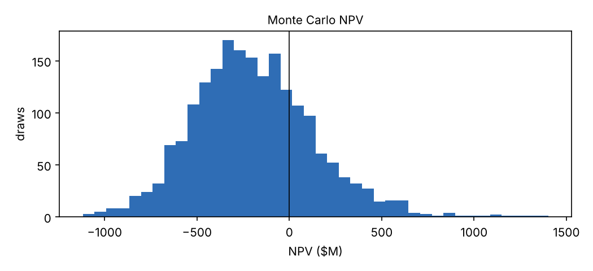

# Automated factories for electrified prefab homes: TEA results

## Conventions

- Real 2026 US dollars (pre-tax). Canadian figures converted at the fx rate below.
- Unit costs are entered at NOAK (Nth of a kind). The cost of getting there is shown separately with Wright's-law learning curves.
- **Boundary:** Design, factory build, transport, set and finish a single-family home, plus energy and service add-ons. Excludes land and lot development.
- **Functional units:** Installed price per sq ft excluding land; months from permit to occupancy; owner's annual cost of home plus energy.
- Company discount rate 10%, customer discount rate 8%, horizon 15 years.

## Headline

| Metric | Value |
|---|---|
| NPV | $147.2M |
| IRR | 19% |
| Probability NPV > 0 (Monte Carlo) | 26% |
| Peak cash need | $265.9M |
| Cash breakeven year | 11 |
| Revenue in final year | $2.09B |
| NOAK reached in year | 8 |
| Extra cost paid while learning (FOAK to NOAK) | $254.6M |
| NPV if costs started at NOAK (no learning period) | $299.3M |

## Customer cost vs BAU

**Installed home, excluding land** ($/sq ft)

| Option | Value | vs ours |
|---|---|---|
| Ours at NOAK price | $175 | 1.00x |
| Conventional modular | $184 | 1.05x |
| Site-built | $217 | 1.24x |
| Manufactured (HUD code, reference) | $87 | 0.50x |
| Ours priced at NOAK full cost | $156 | 0.89x |

Full cost includes factory overhead, capex, selling, warranty and G&A at full utilization.

**Time to occupancy** (months from permit)

| Option | Value | vs ours |
|---|---|---|
| Ours | 4.5 | 1.00x |
| Conventional modular | 6.9 | 1.53x |
| Site-built | 8.8 | 1.96x |

**Owner's annual cost (home + energy)** ($/yr)

| Option | Value | vs ours |
|---|---|---|
| Ours, all-electric with solar + battery | $27,421 | 1.00x |
| Ours, all-electric, no package | $27,003 | 0.98x |
| Conventional modular, mixed fuel | $28,424 | 1.04x |
| Site-built, mixed fuel | $32,911 | 1.20x |

Home price financed over 30 years at the mortgage rate; excludes land, taxes and insurance.

## FOAK to NOAK

Cost multiplier vs the incumbent's cost for each component (1.00 = incumbent).

| Component | FOAK | NOAK |
|---|---|---|
| structure | 1.91 | 0.65 |
| mep | 1.51 | 0.75 |
| finishes | 1.61 | 0.80 |
| site | 1.16 | 0.95 |
| final | 1.10 | 0.90 |

## Cash flow

| Year | Phase | Revenue | Gross profit | Operating cost | EBIT | Capex | Cumulative cash | Cost vs incumbent |
|---|---|---|---|---|---|---|---|---|
| 1 | R&D | $0 | $0 | $15.0M | -$15.0M | $0 | -$15.0M | 1.63 |
| 2 | R&D | $0 | $0 | $15.0M | -$15.0M | $0 | -$30.0M | 1.63 |
| 3 | commercial | $33.1M | -$19.2M | $11.0M | -$30.2M | $10.0M | -$70.2M | 1.63 |
| 4 | commercial | $99.3M | -$32.6M | $13.0M | -$45.6M | $10.0M | -$125.8M | 1.37 |
| 5 | commercial | $198.6M | -$29.2M | $16.0M | -$45.1M | $20.0M | -$190.9M | 1.17 |
| 6 | commercial | $331.0M | -$8.0M | $19.9M | -$27.9M | $20.0M | -$238.9M | 1.04 |
| 7 | commercial | $496.6M | $27.9M | $24.9M | $3.0M | $30.0M | -$265.9M | 0.95 |
| 8 | commercial | $695.3M | $82.0M | $30.9M | $51.1M | $30.0M | -$244.7M | 0.88 |
| 9 | commercial | $894.1M | $137.2M | $36.8M | $100.3M | $30.0M | -$174.4M | 0.84 |
| 10 | commercial | $1.09B | $168.8M | $42.8M | $126.0M | $30.0M | -$78.4M | 0.84 |
| 11 | commercial | $1.29B | $200.4M | $48.8M | $151.7M | $30.0M | $43.3M | 0.84 |
| 12 | commercial | $1.49B | $232.2M | $54.7M | $177.4M | $30.0M | $190.7M | 0.84 |
| 13 | commercial | $1.69B | $263.9M | $60.7M | $203.2M | $30.0M | $363.9M | 0.84 |
| 14 | commercial | $1.89B | $295.7M | $66.7M | $229.1M | $30.0M | $563.0M | 0.84 |
| 15 | commercial | $2.09B | $327.6M | $72.6M | $255.0M | $30.0M | $788.0M | 0.84 |

Revenue in the final year by stream:

- homes: $1.99B (95%)
- energy: $97.5M (5%)
- vpp: $1.4M (0%)
- service: $2.2M (0%)

## Break-evens

| Question | Answer | Base input |
|---|---|---|
| Factory capex for NPV = 0 | 20,858,578 | 10,000,000 |
| Factory utilization for NPV = 0 | 0.61 | 0.8 |
| Price discount vs conventional modular for NPV = 0 | 0.0879 | 0.05 |
| MEP cost reduction for NPV = 0 | 0.0402 | 0.25 |

## Scenarios

| Scenario | NPV | Final-year revenue | Peak cash need |
|---|---|---|---|
| Homes only (no add-ons) | $101.4M | $1.99B | $277.9M |
| + Energy package | $144.0M | $2.08B | $266.1M |
| + Energy package + VPP | $145.7M | $2.09B | $266.0M |
| Base case (energy + VPP + service) | $147.2M | $2.09B | $265.9M |
| Base + panels for other builders | $172.5M | $2.19B | $257.9M |
| Base + ADU line | $196.0M | $2.11B | $252.4M |
| All add-ons | $221.2M | $2.21B | $244.5M |

## Sensitivity (one input at a time)

| Input | Low | NPV at low | High | NPV at high |
|---|---|---|---|---|
| `factory.capacity` | 150 | -$126.6M | 500 | $848.1M |
| `factory.capex` | 5,000,000 | $215.0M | 50,000,000 | -$395.1M |
| `price.discount_vs_modular` | 0.0 | $341.6M | 0.15 | -$241.5M |
| `bench.modular_discount` | 0.1 | $364.4M | 0.2 | -$70.0M |
| `learning.noak_experience` | 2,000 | $232.6M | 20,000 | -$171.9M |
| `cost.noak_reduction_structure` | 0.2 | -$34.8M | 0.5 | $329.2M |
| `cost.noak_reduction_finishes` | 0.05 | -$10.7M | 0.35 | $305.1M |
| `home.sqft` | 1,200 | $1.5M | 2,400 | $292.9M |
| `factory.fixed_opex` | 2,000,000 | $217.3M | 6,000,000 | -$63.2M |
| `factory.utilization` | 0.6 | -$8.1M | 0.95 | $264.0M |
| `cost.transport_set` | 0.03 | $258.1M | 0.1 | -$578,937 |
| `cost.noak_reduction_mep` | 0.1 | $41.9M | 0.4 | $252.5M |
| `finance.company_discount_rate` | 0.08 | $214.4M | 0.15 | $42.4M |
| `company.rd_years` | 1 | $242.2M | 3 | $71.2M |
| `company.ga_share` | 0.02 | $189.2M | 0.06 | $21.3M |

## Monte Carlo

2,000 draws, triangular distribution on every input with a range.

| P10 | P50 | P90 | P(NPV > 0) |
|---|---|---|---|
| -$586.4M | -$214.2M | $223.8M | 26% |

## Kill metrics

| Metric | Value | Threshold | Passes |
|---|---|---|---|
| NOAK full cost vs conventional-modular price | 0.84 x (<=1 to win) | 1.00 | yes |
| Time to occupancy vs conventional modular | 0.65 x (<1 to win) | 1.00 | yes |
| NOAK construction cost vs site-built (incl. transport) | 0.84 x (<=0.85 to win) | 0.85 | yes |
| NOAK margin on homes after overhead, capex, selling, warranty and G&A | 0.11 fraction | 0.10 | yes |
| Revenue at full scale vs big-enough line | 2.09 x | 1.00 | yes |
| Probability NPV > 0 | 26% | 50% | no |

## Scorecard

Economics is scored from P(NPV > 0); the rest are judgment scores set in the inputs file.

| Category | Weight | Score |
|---|---|---|
| impact | 20% | 4 |
| breakthrough | 20% | 3 |
| feasibility | 15% | 3 |
| economics | 15% | 2 |
| scalability | 10% | 4 |
| demand | 10% | 4 |
| white space | 5% | 2 |
| validation | 5% | 2 |
| **Weighted total** | | **3.15** |

## Notes

- Market check: year-15 output is 6,300 homes/yr, vs ~30,000 modular + panelized homes built in the US in 2025 (3% of single-family).
- Owner check: the solar + battery package pays for itself in the mortgage only above $0.215/kWh (base $0.165); all solar output is valued at the retail rate, which flatters it under net billing.
- Cost multipliers are relative to the site-built construction cost (NAHB 2024: $162/sq ft); 'Cost vs incumbent' in the cash flow includes transport and set.
- Operating profit is before depreciation; factory capex is a separate cash outflow. No taxes, working capital or terminal value.
- Federal 45L and 25D credits ended in 2026, so no subsidies are counted.

